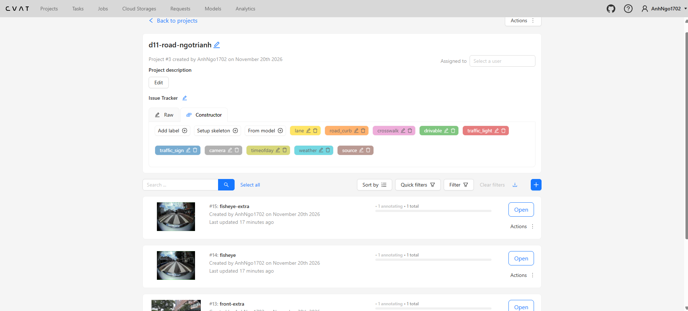
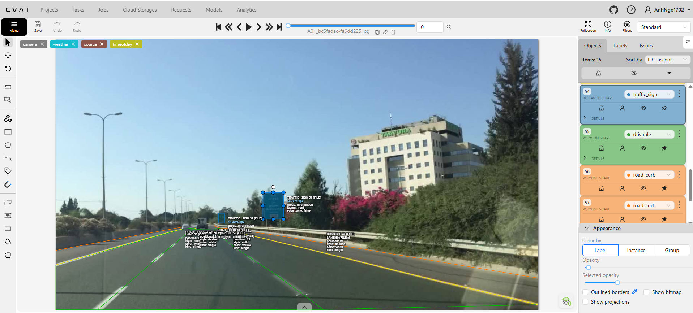
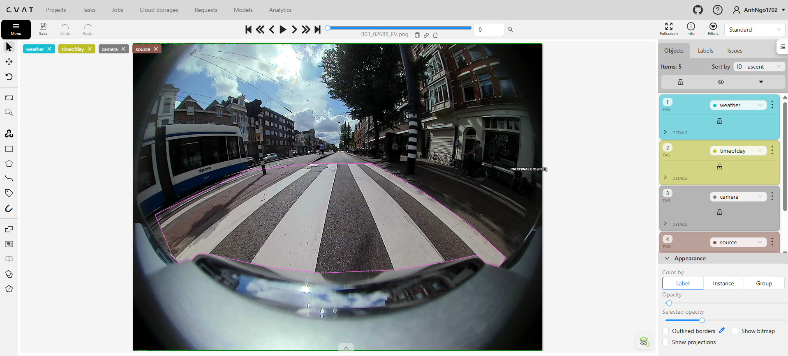
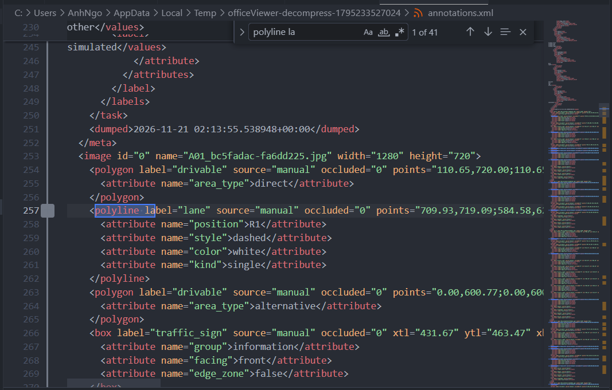

# Báo cáo cá nhân — Ngày 11

Họ tên: Ngô Trí Anh. Mã học viên: 2A202604053.

Guideline: Road v1.0. Tên file bàn giao: nta.

Bộ bàn giao **revision 2**, lập ngày 21/11/2026. Theo yêu cầu của học viên, dùng các ZIP import làm nguồn cuối và ghép core/extra thành hai ZIP front/fisheye. Nhãn giữ nguyên so với bộ import đã sửa. Học viên thông báo đã liên hệ coach và xử lý các ca tồn đọng. Đã nhận phiếu Hoàng Mạnh Hùng kiểm nta revision 1; quyết định Rework. Phản hồi và đối chiếu bộ cuối ở mục 4.

Phiên bản ứng dụng CVAT: chưa xác nhận từ Help → About; XML version=1.1 chỉ là phiên bản định dạng. `meta/task/updated` front là 2026-11-20 11:55:01 UTC, fisheye là 2026-11-21 01:18:29 UTC; đây không phải thời điểm export. Manifest gốc được tạo 21/11/2026 lúc 09:18:49 giờ Việt Nam. Số lần nộp lại thực tế: chưa xác nhận.

## 1. Kiểm project

| Mục | Bằng chứng | Ghi chú |
| --- | --- | --- |
| 6 label, đúng kiểu | Có khai báo trong XML export | Có ảnh screenshot/project.png: project #3 d11-road-ngotrianh |
| Thuộc tính và giá trị | Đọc được trong XML | B07/B08 và A08/A09 đã sửa position trong bản cuối |
| 4 tag ảnh | Đủ trên 28 ảnh, kể cả B11 chưa có shape | B10 đã sửa camera=fisheye_left |
| File và manifest | SHA256 và số byte của hai ZIP gốc khớp manifest | Không kèm ảnh; mở lại được |

Cách kết thúc polyline và đặt tag trên phiên bản CVAT thực dùng: cần người làm xác nhận. Tài liệu repo hướng dẫn phím N và công cụ Tag → Details → value; chưa coi đó là thao tác đã được xác nhận trên phiên bản đang dùng.

## 2. Số lượng đã gán

Số liệu theo bốn task nguồn; bản cuối ghép thành hai ZIP: front A01–A16, fisheye B01–B12, giữ nguyên số shape và tên ảnh.

| Task | Ảnh | lane | road_curb | crosswalk | drivable | traffic_light | traffic_sign |
| --- | ---: | ---: | ---: | ---: | ---: | ---: | ---: |
| front (12/12 ảnh có shape) | 12 | 26 | 15 | 4 | 23 | 35 | 29 |
| front-extra (4/4 ảnh có shape) | 4 | 9 | 4 | 3 | 9 | 8 | 13 |
| fisheye (8/8 ảnh có shape) | 8 | 6 | 2 | 11 | 0 | 4 | 2 |
| fisheye-extra (3/4 ảnh có shape) | 4 | 0 | 0 | 4 | 0 | 0 | 0 |

20/20 ảnh bắt buộc có shape; 7/8 ảnh thêm có shape. B11 chỉ có tag. Có shape không đồng nghĩa đủ label hoặc đúng hình học. Chưa có slide kế hoạch để xác nhận phạm vi label của từng ảnh; cần rà đặc biệt các ảnh fisheye yêu cầu drivable.

## 3. Bảng ca khó

| Ảnh | Nhãn | Phân vân giữa | Xử lý hiện tại | Lý do |
| --- | --- | --- | --- | --- |
| A05 | lane | thiếu L1/R1 hay không có vạch thực | Không thêm vạch giả; học viên thông báo đã trao đổi coach và xử lý | Ảnh đường phố có xe đỗ hai bên, không thấy vạch sơn |
| A06 | lane | biên làn hay vạch sang đường | Không thêm R1 giả; thuộc nhóm ca học viên đã thông báo trao đổi coach và xử lý | Phía phải có cột và lề; nhiều vạch ngang ở giao lộ |
| A07 | lane | thiếu L1 hay biên trái là dải phân cách | Học viên thông báo đã trao đổi coach và xử lý | Không tự coi mép bê tông là vạch sơn |
| A08 | lane | biên ngoài bên trái hay bên phải | Đã sửa vạch ngoài bên phải L2→R2; phiếu nhận được ghi có vạch trái nhưng bộ cuối chưa có L1, cần xử lý riêng | Đường này nằm phía ngoài bên phải R1 trên ảnh |
| A09 | lane | vạch trái đôi và vạch phải đứt | Bản r2: lane#5 L1→R1; lane#6 L2→L1 | Đối chiếu ảnh: vạch đôi nằm trái làn xe, vạch đứt nằm phải |
| B07/B08 | lane | L/R hay other | Bản r2 đổi 4 lane thành other | Camera hai bên theo guideline luôn dùng other; tính hợp lệ và hình học lane cần rà riêng |
| B02 | traffic_light | edge_zone false/true | Bản r2 bật true cho 2 box | Tâm box nằm ngoài 80% bán kính theo checker |
| B10 | camera | fisheye_right/fisheye_left | Bản r2 sửa fisheye_left | Hậu tố MVL trong tên ảnh |

## 4. Phiếu QC 1 nhận được và phản hồi

Người kiểm: **Hoàng Mạnh Hùng**. Ngày: 21/11/2026. Phiếu gốc: `hoanghung-qc1-for-nta.md`, kiểm revision 1, được giữ nguyên. Quyết định nhận được: **Rework** vì 4 lỗi QC1-03 ở B07/B08; không diễn giải quyết định đó thành Release cho revision 2 khi chưa được kiểm lại.

Phạm vi core: 20 ảnh, **237 nhãn = 157 shape + 80 tag**. Phiếu ghi 4 lỗi nặng chắc chắn, 6 trường hợp thiếu L1/R1 chờ xác nhận, 12 lỗi nhẹ theo shape và 0 lỗi chính đã xác nhận. Ảnh thêm được ghi riêng. Tỷ lệ 0/237 trong phiếu là của revision 1 và các lỗi đã xác nhận tại thời điểm kiểm, không phải điểm chất lượng hoặc kết luận cho bộ cuối.

| Mã | Số lượng và nội dung phiếu | Phản hồi | Đối chiếu bộ cuối revision 2 |
| --- | --- | --- | --- |
| QC1-03 | 4 lane B07 #2/#3/#4, B08 #0 sai position | Đồng ý | Đã kiểm XML: cả 4 lane đều other |
| QC1-12 | 12 shape core có đỉnh trùng liên tiếp | Đồng ý | Đã xóa đỉnh trùng; kiểm không còn cặp điểm liên tiếp bằng nhau |
| QC1-01 extra | B10 camera sai right/left | Đồng ý | Đã kiểm camera=fisheye_left |
| QC1-12 extra | A14 crosswalk #6, A15 drivable #3 có đỉnh trùng | Đồng ý | Đã xóa đỉnh trùng, giữ hình học |
| QC1-11 | B02 hai đèn #2/#3 có thể thiếu edge_zone | Đồng ý với sửa theo ngưỡng checker | Hai box đã bật true trong bộ cuối |
| QC1-05 | B07 hai polyline R1 có thể là vạch đứt bị tách | Chưa đủ căn cứ kết luận là cùng vạch | Position đã thành other; không tự nối các shape chỉ vì từng trùng position |
| QC1-02 | A05 không có vạch; A06 không thấy R1; A07 không thấy L1 theo cột lời đáp của phiếu | Giữ không vẽ thêm | Các cảnh báo thô vẫn còn; phiếu chưa ghi người/ngày xác nhận lời đáp |
| QC1-02 | A09 có vạch phải theo phiếu | Đồng ý | Đã sửa position lane #5 thành R1, lane #6 thành L1; bộ cuối đủ L1/R1 |
| QC1-02 | **A08 có vạch trái theo phiếu** | **Cần làm rõ, chưa thể ghi đã sửa** | Bộ cuối chỉ có R1/R2, chưa có L1. Việc đổi vạch ngoài bên phải từ L2→R2 không bổ sung vạch trái |
| QC1-02 extra | A14 thiếu R1 chờ xác nhận | Chưa có lời đáp riêng trong phiếu | Cảnh báo còn trong manifest |

Học viên trước đó thông báo đã liên hệ coach và xử lý. Tuy nhiên phiếu nhận được ghi A08 có vạch trái, còn bộ import được chọn làm final vẫn thiếu L1. Cần đối chiếu lại quyết định coach hoặc sửa vạch nhìn thấy và kiểm lại trước khi kết luận đóng lỗi này. Không thêm một polyline suy đoán để xóa cảnh báo, không tự ghi coach đã miễn A08.

Các điểm nên nhờ người kiểm làm rõ trong phiếu gốc (không tự sửa thay):

- Tổng 237 nhãn khớp core. Phiếu nói kiểm 4 ZIP nhưng manifest revision 1 chỉ chứa hash của 2 ZIP core; cần phân biệt phần xác minh hash core với 2 ZIP extra.
- QC1-02 ghi 20 mục kiểm nhưng 6 sự kiện thiếu vạch: nên nói rõ kiểm theo ảnh hay vị trí trái/phải. A05 có 2 vị trí thiếu, nên số lời đáp/case không đồng nhất số lỗi.
- 12 lỗi nhẹ core là số shape, trong khi danh sách lỗi nhóm nhiều shape vào một dòng; tổng theo shape hợp lý nhưng nên ghi rõ đơn vị. E3 ảnh thêm đang gộp tên ảnh/shape vào cột Ảnh, có thể tách 2 dòng để dễ tìm.
- Các ô B07 và B02 chưa có lời đáp; cần cập nhật sau khi kiểm lại revision 2. Số “ca chờ lead: 7” cần cập nhật theo lời đáp hiện có, không suy ra từ số dòng cũ.

Các sửa position A08/A09 ngoài phạm vi 4 lỗi QC1-03 nêu trong phiếu là kết quả tự kiểm trước đó. Bản gốc revision 1 vẫn giữ trong repo. Chưa nhận quyết định kiểm lại revision 2.

## 5. Kiểm file bàn giao

| File | Mở lại được? | Shape ảnh 1 (job / file) | Shape ảnh 2 (job / file) | Camera trong XML? |
| --- | --- | --- | --- | --- |
| nta-front.zip, 16 ảnh | Có | A01: ảnh chụp Items=15 gồm 4 tag, tương ứng 11 shape / 11 | chưa có ảnh chụp A02 / 7 | Có |
| nta-fisheye.zip, 12 ảnh | Có | B01: ảnh chụp Items=5 gồm 4 tag, tương ứng 1 shape / 1 | chưa có ảnh chụp B02 / 4 | Có |

Hai ZIP chỉ chứa annotations.xml, không kèm ảnh. Manifest mới ghi SHA256, số byte, đủ 28 ảnh và bốn tag/ảnh. Kiểm tra trước/sau ghép xác nhận tọa độ, thuộc tính, tag và thứ tự shape không thay đổi. XML được đóng gói cục bộ từ bộ import do học viên chọn, không mô tả là một lần export mới từ CVAT.

Lint còn 6 cảnh báo QC1-02: A05 L1/R1, A06 R1, A07 L1, A08 L1, A14 R1; và 7 gợi ý box nhỏ dưới 8 px (không tự động là lỗi chấm). Không có cảnh báo chính từ lint. Đã có phiếu QC revision 1 để đối chiếu: A05/A06/A07 ghi không thấy vạch; A08 ghi có vạch trái nhưng bộ cuối chưa có L1, cần làm rõ như mục 4. B11 là ảnh thêm chỉ có tag, không yêu cầu tính điểm thưởng cho ảnh này.

Ảnh project được cung cấp còn hiển thị task fisheye/fisheye-extra ở trạng thái annotating. Chưa có ảnh sau đó để xác nhận completed. Không suy ra phiên bản ứng dụng CVAT hay thời điểm export cuối từ các ảnh hiện có.

## 6. Ảnh chụp màn hình

Project #3, sáu label và bốn tag:

Front A01 có lane, drivable, road_curb, traffic_sign:

Fisheye B01 có crosswalk và bốn tag:

Ảnh fisheye hiện minh họa crosswalk, chưa phải ảnh phóng to polyline lane cong theo yêu cầu mẫu báo cáo.

XML có polyline label=lane và các thuộc tính:

## 7. Tự đánh giá

Trong các cảnh báo lint gốc của 20 ảnh core, nhóm đỉnh trùng QC1-12 xuất hiện nhiều (12 shape); nhóm lỗi ngữ nghĩa rõ là QC1-03 ở camera hai bên (4 lane), ngoài các lỗi position front phát hiện bằng mắt. Cách tránh: kiểm Details sau khi vẽ, kiểm camera trước position, không nhấp hai lần tạo đỉnh trùng. Chưa thể kết luận lỗi hình học nào nhiều nhất nếu chưa đối chiếu GT.

Ví dụ lỗi đã sửa: B07/B08 gán L1/R1 tại camera hai bên sẽ đưa ý nghĩa làn xe phía trước vào cảnh nhìn ngang. Nhãn position sai làm mô hình học sai vai trò vạch; sửa other giúp giữ đúng quy ước dữ liệu. B10 sai camera còn khiến cảnh nhìn trái bị thống kê vào nhóm nhìn phải. Những sửa này không thay thế việc kiểm vạch có đúng đối tượng hay không.

## 8. Tùy chọn: row-anchor A01, R1

Tính bằng `road_lab.rowanchor`, nội suy polyline riêng của mỗi bài, không coi bài nào là GT.

| y | 720 | 680 | 640 | 600 | 560 |
| --- | ---: | ---: | ---: | ---: | ---: |
| nta | không có làn | 657.1 | 602.9 | 543.5 | 484.1 |
| hoanghung | không có làn | không có làn | 599.9 | 541.6 | 484.0 |

1. Hàng mất đích khi nằm ngoài phạm vi y của polyline sau khi cắt; phải biết cắt ở đầu gần hay đầu xa và tọa độ mới. A01 R1 của Hoàng Mạnh Hùng kết thúc đầu gần tại y≈677.64, nên y=680 không có đích trong khi nta còn có. Không suy ra một hàng cố định chỉ từ câu “dừng sớm 40 px” khi chưa biết cắt đầu nào.
2. Tại y=720 cả hai không có làn vì điểm đầu đều nhỏ hơn 720, không tính được độ lệch số. Tại y=560 hai bài lệch khoảng 0.05 px. Sai lệch phần gần xe tác động trực tiếp tới ước lượng vị trí ngang dùng điều khiển, nhưng không suy ra mức tác động định lượng chỉ từ pixel ảnh.
3. Đảo thứ tự toàn bộ điểm không đổi giao điểm hình học với hàng ngang, nên nội suy x vẫn vậy nếu giữ cùng đường. Checker quy tắc chiều gần→xa vẫn báo lỗi; pipeline nào giả định điểm đầu là gần xe cần xử lý lại. Không khẳng định `rowanchor.py` sai vì phép nội suy của nó kiểm cả hai chiều đoạn.
